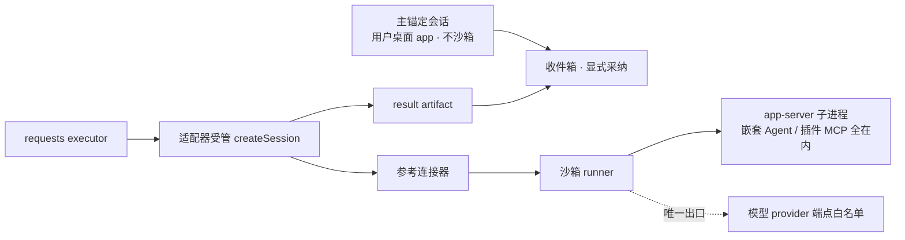

# RoleDock 适配器强制隔离(沙箱执行边界)实施计划

日期：2026-10-24  
状态：已决策（[ADR-0012](adr/0012-adapter-enforced-isolation.md)）；P5-H 增量 B0–B4 与 G-min 已独立验收 PASS（见 [P5-H-b4-review](phase-reports/P5-H-b4-review.md)、[P6-G-min-review](phase-reports/P6-G-min-review.md)），G01 仅剩 Z03 BLOCKED，本计划为其收口路径  
基线：HEAD `a083874e60e7a40d88a18e075b699b1fb818b0e1` + 未提交工作区（B0–B4/G-min 已验收；自 B4 门禁证据后无源码改动）  
关联：[开发蓝图](DEVELOPMENT_PLAN.md)、[ADR-0009](adr/0009-trusted-connections-and-anchor.md)、[ADR-0010](adr/0010-zcode-restricted-integration.md)、[ADR-0011](adr/0011-human-authorization-entry-reservation.md)、[适配器契约](spec/adapter-contract.md)、[连接器工具契约](zcode-connector-tools.md)

## 1. 决策摘要与目标

四项隔离（context / temp_writes / results / capability_scope）不再等待宿主官方机制，改由 RoleDock 自有执行边界强制：被隔离的咨询分支宿主进程跑在 RoleDock 启动的 OS 沙箱内，`isolation.*` 声明的语义从"宿主强制"变为"适配器保证"，验收标准是逃逸测试证据而非宿主特性文档（ADR-0012）。

**目标**：独立请求链在真实 ZCode 宿主上以受管沙箱变体完整跑通——四项隔离声明以逃逸证据翻转，05H 验收链步骤 7–8（独立请求×10 重叠 + 收件箱采纳）真实复验，G01-Z03 关闭，P5-H 收口。

**非目标**：

- 不做逐工具白名单或宿主工具级隔离声明（强制在效果层，见 §2）；
- 不沙箱用户桌面 app 中的主锚定会话（owner 授权的用户对话，非委托执行）；
- 不做 Windows/macOS 首版支持；
- 不防御内核逃逸或同机同用户全权恶意代码（ADR-0009 边界不变）；
- 不重做 B0–B4 已验收路径（真人事件、身份验证、载入对账、cancel/close/预算全部复用）。

## 2. 总体设计与强制位置

| 隔离 | 强制位置 | 机制 |
| --- | --- | --- |
| context | 结构保证 + 沙箱 | 新会话不迁移任何历史；材料载入只带接收时冻结的快照；沙箱禁读工作区私有区与 owner 连接文件 |
| temp_writes | 沙箱 | 仅白名单临时目录可写（tmpfs），对应既有 `CreateSessionInput.temp_dir` 契约钩子 |
| results | 协议层（既有） | 收件箱归并、主会话零注入，不依赖沙箱；沙箱侧禁写 owner socket 与主会话通道 |
| capability_scope | 效果层 | 沙箱基线统一限制一切工具效果；每请求能力收窄属 RoleDock 材料/策略语义，不声明宿主工具级隔离（ADR-0012 §2） |

设计规则：

1. **失败关闭**：runner 缺失、启动失败或发现逃逸 → 拒绝执行或如实 uncertain，绝不无沙箱降级运行而仍声明隔离。
2. **凭据不进沙箱**：owner token、宿主账户存储留在边界外；模型 API 头经连接器 RPC 按需注入（B3 既有 `interaction/requestProviderRuntimeHeaders` 机制）。
3. **材料路径白名单**：内容寻址材料目录 `.roledock/anchor-materials/` 以只读方式挂入沙箱（载入轮需读材料文件）。
4. **边界覆盖全进程树**：pid namespace + cgroup，嵌套 Agent、插件 MCP、被 spawn 的孙进程全部落在同一边界内。
5. **声明与证据分离**：翻转 `isolation.*` 前，B5-2 逃逸证据集与 B5-3 全链证据必须已在案并经独立验收。
6. **实现位置**：沙箱 runner 封装先落在 `adapters/zcode`（连接器 `--sandbox` 参数，默认关闭，不影响既有路径）；出现第二个需要受管模式的宿主时再抽取公共组件，不预建空壳包。

## 3. 增量分解（P5-H 增量 B5 系列）

一次一个增量，每增量独立报告与验收（`prompts/REVIEW.md`），报告 `P5-H-b5N-development.md`。

| 增量 | 交付 | 必须通过的退出条件 |
| --- | --- | --- |
| B5-0 契约预留 | ADR-0012 落档；`adapter-contract.md` 增加"受管执行与隔离证据"语义（isolation.* = 适配器保证 + 逃逸证据标准）；`zcode-connector-tools.md` §4.5 受管执行草案（沙箱 spawn 参数、runner 探测语义）；阶段门文档登记（AGENTS.md、DESKTOP_GUI_PLAN §8、prompts/README.md）；连接器 `--sandbox` 参数预留（默认关闭） | 文档与契约齐备；全量门禁绿；四项声明不变 |
| B5-1 沙箱执行器技术验证 | runner 选型验证（bubblewrap / systemd-run / 容器运行时，按本机可运行性定档 `toolchain.md`）；受管模式最小真实链：沙箱内 app-server 创建裸会话 → 1 个真实模型轮（send/status）→ 出口白名单放行 provider 端点 → 凭据经 helper RPC 注入 → 进程树回收 | 真实运行日志；沙箱内完成模型轮；无 owner 凭据进沙箱；runner 缺失路径如实 NOT_IMPLEMENTED；并发 2–3 个沙箱实例烟测通过 |
| B5-2 逃逸测试证据集 | §4 逃逸矩阵全部条目的 fixture 测试 + 真实沙箱执行证据；矩阵固化为可重跑脚本（证据随 phase-reports 留档） | 每项有真实执行证据且结果为"被拦截"；任何一项逃逸 = REWORK；本增量结束仍不翻转声明 |
| B5-3 请求链受管接入 | 核心 requests executor 接线：咨询分支经受管 `createSession`（`temp_dir`/`capability_scope` 输入在受管路径生效）；材料目录只读白名单；**10 个重叠请求在沙箱实例真实完成** → artifact → 收件箱 → 主会话显式采纳；预算/取消路径在受管模式回归 | 05H 步骤 7 真实证据（10 重叠请求、零主会话注入）；步骤 8 真实证据（收件箱采纳）；既有请求语义测试全绿 |
| B5-4 声明翻转与收口 | `isolation` 四项翻转 true（随受管执行声明）；05H 全链八步复验；P5-H 复审收口材料 | 独立验收通过；G01-Z03 关闭；P5-H BLOCKED 解除；zcode 以受管变体进入 conformance 套件 |

## 4. 逃逸测试矩阵（B5-2 验收基线）

| # | 逃逸尝试 | 必须观察到的结果 |
| --- | --- | --- |
| 1 | 写 workspace 外 / 白名单外路径 | 写失败，无落盘 |
| 2 | 读主会话私有文件（owner-connection.json、个人目录） | 读失败或为空 |
| 3 | 连接非白名单网络端点 | 连接失败 |
| 4 | 模型在轮内调用 Bash / Write 等宿主工具 | 工具可运行，但全部效果限于边界内（效果层语义的正面验证） |
| 5 | 嵌套 Agent / 子进程再 spawn | 全部落在同一 pid namespace，边界不衰减 |
| 6 | 插件 / 全局 MCP server 加载 | 其网络与文件效果同受边界约束 |
| 7 | 常见容器逃逸路径尝试 | 被拦截 |
| 8 | runner 缺失 / 启动失败 / 中途消亡 | NOT_IMPLEMENTED 或 uncertain，绝不无沙箱降级 |

## 5. 风险与开放问题

- **runner 依赖可用性**：bubblewrap / systemd-run / 容器运行时在用户机器未必存在 → 启动时探测，缺失即如实拒绝（失败关闭）；选型结果定档 `toolchain.md`，版本精确固定。
- **出口白名单维护**：provider 端点随账户/版本变化 → 配置化传入，不硬编码；白名单外一律拦截。
- **沙箱内待人请求**：连接器从不自动应答（B4 既有姿态）；受管模式同样 park → 适配器 needs_input/uncertain 路径处理，不新增自动授权。
- **性能**：每请求会话增加沙箱启动开销（百毫秒级），对咨询请求可接受；B5-1 记录实测基线。
- **capability_scope 语义边界**：效果层基线对全部受管会话统一，不按请求逐工具收窄——验收按 ADR-0012 §2 语义审查，不要求超出声明的证明。
- **conformance 套件接入**：B5-3 后以受管变体进入 `defineAdapterContractSuite`，消解 B4 报告 §3 的排除理由；套件工厂语义是否需要为"受管变体"调整，在 B5-3 增量内决定并记录。

## 6. 与既有计划的关系

- `DESKTOP_GUI_PLAN.md` §8：P5-H 收口路径由本计划补充；P6-G 前置仍为 P5-H 复验通过，本计划完成不自动开工 P6-G。
- 05H 验收链：步骤 1–6 已有真实证据（B4 报告 §4），本计划闭合步骤 7–8。
- 复用清单：真人授权事件（B2）、身份验证（B1）、载入四判据与对账（B3）、cancel/close/支出前预算（B4）——受管模式只新增执行边界，不改这些已验收行为。
