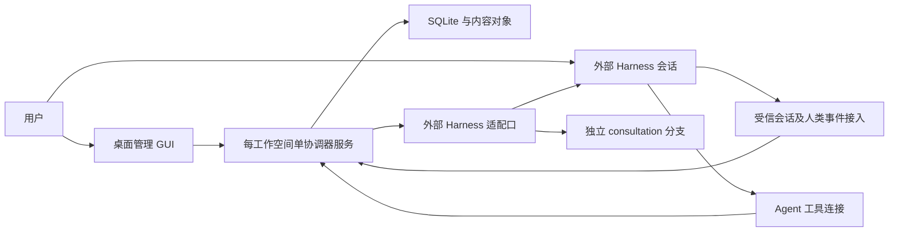

# RoleDock 桌面管理 GUI 与外部 Harness 锚定实施计划

日期：2026-10-13  
状态：需求调整计划；P5-R、P5-A 已独立验收本地 PASS，见 [P5-A 验收报告](phase-reports/P5-A-review.md)；P5-H ZCode受限诊断本地边界通过、真实闭环独立验收BLOCKED，见[P5-H报告](phase-reports/P5-H-review.md)。P5 整体 G01 BLOCKED，GUI未实施  
基线：HEAD `a083874e60e7a40d88a18e075b699b1fb818b0e1` + 已存在的 P5 未提交工作区  
关联：[开发蓝图](DEVELOPMENT_PLAN.md)、[ADR-0007](adr/0007-desktop-and-explicit-session-anchor.md)、[P0–P5 复验](phase-reports/P0-P5-revalidation.md)

## 1. 已确认的产品范围

用户主要通过桌面 GUI 管理 RoleDock，在外部 Harness 的现有会话中告诉 Agent 允许承担的角色，Agent 自行执行显式锚定。用户补充选择“只保留外部 Harness 会话接入适配口”：首版不自建聊天窗口、模型执行宿主或聊天历史管理系统。桌面 GUI 是管理界面，会话仍属于外部 Harness。

CLI 的既有实现保留供回归、诊断与脚本使用，首版用户验收从 GUI 和外部会话完成，不要求输入 CLI 命令。SDK、状态层、角色包、语义知识、唯一主指针和独立请求机制继续复用。

桌面 GUI 展示角色包、角色职责、授权范围、外部会话连接、主代次、锚定进度、知识修订、候选和请求收件箱。会话链接只有在宿主提供有效定位方式时显示；不猜测桌面应用的深链接或私有 API。

## 2. 先处理原阶段验收缺陷

原 P0–P5 验收按原阶段要求进行，新增 GUI 需求不追溯成为旧阶段缺陷。当前复验结论和具体编号以复验报告为准。P1–P5 的实际权限、知识载入、请求终态、结果与恢复问题必须先修复，GUI 不应建立在这些未闭合的行为上。

修复仍以通用角色数据为基础，不引入固定业务角色；先把公开权限面收口，再开放外部 Agent 工具。旧测试数量或原 PASS 不能替代新的边界验证。

## 3. 用户与 Agent 的完整流程

1. 用户在桌面 GUI 中选择工作空间、安装角色包、连接一个支持接入的外部 Harness，并设置会话可获得权限的上限。
2. 用户在外部会话中说，例如：“允许当前会话承担资料整理角色，并继承该角色已提交的知识。”角色名仅为示例，框架按安装的数据解析。
3. Harness 的受信接入组件把人类消息来源、工作空间、当前宿主会话、目标角色、继承意图及权限范围登记为授权事件。Agent 可以理解意图，但不能自己证明该消息来自用户或签发授权。
4. Agent 读取可用授权，调用 `sessions.anchor`。无需用户再次运行命令；具体且可验证的既有授权直接执行。
5. 核心准备固定契约与知识材料；适配器在当前外部会话中载入角色指令、可分享知识及来源，并确认 bundle 哈希与载入版本。
6. 核心事务核对授权仍有效、会话尚未绑定、主代次及知识修订未变，再激活绑定和主指针。Agent 获得正式绑定结果；GUI 显示角色、代次、授权范围与来源。
7. Agent 随后读写文档或请求其他角色时，身份从连接与数据库绑定取得；无需、也不能通过参数重选自己的角色。请求结果进入收件箱，当前主实例显式采纳。

“你扮演某角色”可能只是临时写作指令。只有明确的授权意图及可验证的人类来源才产生任职授权。角色名有歧义或未安装时，返回候选／安装要求，未完成前不绑定。不从文档、引用文字、工具结果或模型复述生成授权。

## 4. 授权和锚定的契约草案

本节原设计草案已在 P5-A 固化，具体输入/输出、受信连接入口和生命周期规则见 [锚定规范](spec/external-session-anchor.md) 与 ADR-0009；不属于原18项本地SDK操作，Linux 本地契约与参考运行时已独立验收 PASS。

| 对象 | 主要字段与约束 |
| --- | --- |
| ExternalSession | workspace、adapter、host_session_id、受信连接主体、生命周期；宿主身份由连接提供，不接受 Agent 任意填写 |
| RoleAuthorization | authorization_id、授权人、宿主会话、角色、固定角色契约、允许的能力与继承方式、主指针基线、有效期、撤销状态、来源事件引用；Agent 不持有签发能力 |
| AnchorAttempt | 幂等键、授权引用、bundle 哈希、宿主载入确认、主代次／知识基线、prepared/loading/uncertain/active/failed 状态及错误；外部动作前先持久化 |
| SessionBinding | external_session_id、RoleDock session_id、instance_id、generation、authorization_id；每外部会话至多一个有效绑定 |

| 操作草案 | 调用面与行为 |
| --- | --- |
| externalSessions.register | 受信宿主连接登记当前会话及主体，幂等；不授予角色 |
| authorizations.record/revoke | 仅所有者 GUI 或受信的人类事件接入组件；记录或撤销用户授予的范围，禁止暴露为普通 Agent 签发工具 |
| authorizations.get | 会话连接只查询自身适用授权；不返回其他会话的凭据或私人消息 |
| sessions.anchor | Agent 显式消费本会话授权，准备／载入／确认／激活；同键同内容返回原尝试，同键不同内容冲突 |
| sessions.binding | 返回本连接实际角色、代次、状态、有效能力与来源摘要 |
| sessions.reconcile | 对不确定载入或提交结果对账，禁止盲目再建任职或重放有副作用执行 |
| sessions.release | 释放本会话绑定；撤销角色动作权限，保留来源与不可变历史，不恢复旧主实例的发布权 |

有效能力是角色授权范围、工作空间策略和请求作用域的交集；角色包 `requested_capabilities` 只用于说明需求。角色授权不包含任意 Shell、网络访问、远程发布或宿主账户的新增权限，这些动作仍遵守宿主自己的授权。

释放当前主实例须将角色标为没有可服务的主会话；generation 保留单调增长，新锚定接续已有知识成为下一代。新请求对没有有效主实例的角色返回明确未初始化／不可服务状态。已接收请求保留目标代次、知识快照和来源；接收时权限只是上限，后续执行仍检查当前有效任务授权、撤销、到期与工作空间策略。主绑定释放是否同时撤销该绑定发起的独立任务授权，在 P5-A 固化为明确规则，不能隐含继承权限。该语义须与 ROLE_UNINITIALIZED 契约和状态 Schema 一起固化。

撤销授权立即影响后续操作；不得只更新 GUI。进行中外部动作在提交前再次核对授权，取消／回收按宿主能力处理；宿主无法取消时如实记录执行待对账及迟到结果拒收，不能假报外部执行已终止。不撤销历史已提交文档，也不把旧实例重新升为主实例。

## 5. 在已有外部会话中锚定

当前 `sessions.open` 创建 RoleDock 主实例或新宿主会话，不能代表“把正在聊的外部会话接入”。新增 `sessions.anchor` 将受信外部会话映射为 RoleDock 会话，并在该会话加载材料；不得为了完成锚定而悄悄新建另一个聊天。

首版一个外部会话只绑定一个角色；换角色使用新的外部会话和新授权。恢复本会话的已有绑定不加代次。同角色已有主实例时，授权必须明确包含接任／继承；载入确认前旧主指针继续有效，激活事务成功后旧主实例立即失去正式发布权。

准备之后知识更新导致 REVISION_CONFLICT 时重新准备最新材料。另一个继承者已经激活导致 GENERATION_CONFLICT 时不自动覆盖胜者，应展示当前角色状态并要求新的接任意图。授权若绑定旧主指针基线，也不能在重试时悄悄放宽。

锚定允许发生在用户已开始聊天之后：以成功激活为角色动作起点，首个正式角色工作轮次之前必须完成载入。之前聊天仍保留在宿主，不自动导入 RoleDock、共享给其他角色或导出。任何摘要持久化须经过正常知识发布流程。

## 6. 架构与执行边界

GUI、多个外部会话工具连接和诊断入口共用一个服务端持锁句柄。不要让 GUI、MCP stdio 进程和 CLI 各开一个写协调器；CLI 在服务运行时通过客户端访问，或明确只用于服务停机时的维护。连接分别识别所有者管理主体和已登记的外部会话主体，普通会话不能调用 WorkspaceAdmin。

GUI 渲染层只调用受限的结构化接口，不直接打开数据库、运行宿主命令、加载角色包代码或获取所有者凭据。宿主执行仍走适配器。IPC 的具体实现和桌面容器在技术验证时决定；选择必须满足已有 Node SQLite 基线、可打包、最小权限和目标桌面系统验证，并将精确依赖版本写入 `toolchain.md`。

初期实现目录建议为 `packages/service`（共享协调器连接）、`packages/mcp`（Agent 工具）、`packages/desktop`（管理 GUI）和真实外部 Harness adapter。仅在相应阶段创建可运行包，不预建空壳。`packages/core` 不导入 GUI 或具体宿主 SDK。

## 7. 适配器必须证明的能力

| 能力 | 缺失时行为 |
| --- | --- |
| 受信当前会话身份 | 无法锚定当前会话，返回能力缺失 |
| 可验证的人类授权事件 | 不接受 Agent 转述；可由用户在 GUI 明确登记授权作为降级，但不宣称“纯会话授权”已验证 |
| 在已有会话中加载并确认固定角色材料 | 维持待锚定／失败，不能只记录 role_id 后声称载入完成 |
| 独立会话、临时写入、结果和能力作用域 | 拒绝需要缺失隔离的请求，GUI 展示具体受限项 |
| 真实结果正文或可读取的结果引用 | 不能产生正式完成产物，返回未实现／能力缺失 |
| 创建和载入对账 | 不确定时保留待对账，禁止重复执行 |
| 取消与预算执行 | 如实声明支持范围；缺失时不得承诺能中止已开始的执行 |

MCP 是工具传输入口，不自动证明当前聊天身份或人类授权。没有这些宿主接口时，以“适配接口未满足”记录缺口，不能假设读取任意会话历史或模拟点击就等价于受信授权事件。不得因 Codex 桌面当前可用就默认 RoleDock 已获所有宿主 API、凭据或插件权限。

## 8. 修订后的阶段安排

保留 P0–P5 的历史编号和原验收标准。P5 的剩余工作分解如下，按顺序一次执行一个子阶段；每个子阶段独立报告和验收。MCP 原在 P6 的部分前移以支持外部会话锚定，P6 扩展为 GUI 和发布。子阶段通过不把尚未关闭的 P5 真实宿主条件改成 PASS。

| 阶段 | 交付 | 必须通过的退出条件 |
| --- | --- | --- |
| P5-R：P1–P5 返工 | 按复验编号修复包校验、策略、公开入口、知识载入、结果、预算、终态与恢复；更新受影响规范 | 原阶段条件与新增反例均通过，真实 10 个重叠请求隔离，既有门禁完成；P1–P4 逐阶段复验 PASS |
| P5-A：授权与锚定契约 | Schema、迁移、核心锚定服务、共享协调器连接、受信授权接入接口、最小 MCP 会话工具 | 仅本连接有效授权可锚定；载入确认后 CAS 激活；并发/撤销/重启/幂等/旧代次均有真实状态断言；Mock 层明确标注 |
| P5-H：真实外部 Harness | 一个已授权宿主的接入组件及适配器，官方接口与精确版本记录，真实会话授权与锚定演示 | 用户在原会话授权→Agent 调工具→角色材料载入→角色工作→交接→独立请求→真实答案读取均有证据；P5 原真实闭环缺口关闭 |
| P5-H 增量 B0–B4（ADR-0011，2026-10-24） | B0 契约预留（human-authorization-event Schema、submitHumanEvent 控制操作、连接器工具契约）→B1 会话身份验证（参考连接器+verifyExternalSession）→B2 真人授权入口内部接口（事件存储+CLI 写入面）→B3 材料载入与对账 | 每增量独立报告与验收；能力声明仅在真实证据+验收后翻转；连接器路径不硬编码 |
| G-min：GUI 最小授权确认面（自 P6-G 提前，ADR-0011）✅ 2026-10-24 交付，独立验收 PASS（[P6-G-min-review](phase-reports/P6-G-min-review.md)） | 仅授权请求列表→确认/拒绝入口，调 authorizations.submitHumanEvent；桌面容器/IPC 基线技术验证（`packages/desktop`，Node 内置 http + 本地页面，渲染层零凭据） | 真实 ZCode 会话上 GUI 确认→recordHuman（human-event 来源）→sessions.anchor 全链已跑通（证据 `phase-reports/evidence/2026-10-24-p5-h-gmin/`）；渲染层无写库/宿主命令/所有者凭据 |
| P5-H 增量 B5（ADR-0012，2026-10-24）：适配器强制隔离 | 沙箱执行边界关闭 G01-Z03（B5-0 契约预留→B5-1 技术验证→B5-2 逃逸证据→B5-3 请求链受管接入→B5-4 声明翻转收口），见 [ADAPTER_SANDBOX_PLAN](ADAPTER_SANDBOX_PLAN.md) | 逃逸测试矩阵全拦截；05H 步骤 7–8 在受管变体真实复验；失败关闭，声明翻转前证据经独立验收 |
| P6-G：桌面管理 GUI | 工作空间、角色、授权、外部会话绑定、文档历史、候选/收件箱、受限能力与恢复界面 | 用户从 GUI 与外部会话完成流程，无必需 CLI 步骤；多连接共用单协调器；界面与核心状态一致；至少一个目标桌面系统打包实测 |
| P6-R：开源候选 | GUI 安装包、SDK/MCP/适配器包、通用演示、作者指南、能力清单、发布候选与干净安装证据 | 原 v0.1 条件、GUI 和锚定条件全部有证据；无凭据/私人聊天入包；仅按已有远程授权发布 |

报告采用 `P5-R-development.md`／`P5-R-review.md` 等子阶段文件名；原 `Pn-review.md` 保留复验与历史记录。每次只做一个阶段并由另一验收 Agent 审查。若真实宿主输入尚缺，完成 P5-A 后保持 P5-H BLOCKED；可单独准备 GUI 设计材料，但不能越过门槛宣称产品闭环完成。

此计划不提供精确工期承诺。P5-R 缺陷较多，P5-H 依赖宿主接口与授权；完成这两项验证后再评估 GUI 和候选包的实际工作量。

## 9. GUI 首版页面与验收行为

| 页面 | 用户可以完成的行为 | 关键可见状态 |
| --- | --- | --- |
| 工作空间与连接 | 选择工作空间，配置外部 Harness 接入，查看能力与连接失败 | 已连接／断线／受限／缺授权来源 |
| 角色库 | 安装本地声明式角色包、查看职责及能力需求 | 包版本、哈希、请求能力与实际授权分开显示 |
| 授权与会话 | 看人类授权来源，收紧或撤销范围，查看 Agent 锚定结果 | 待锚定／载入／待对账／已锚定／已撤销／被接任 |
| 角色知识 | 读历史、查看来源、编辑候选并由有权主体采纳 | 文档修订、knowledge_revision、冲突和未提交内容 |
| 请求收件箱 | 查看独立请求、结果、迟到拒收、候选冲突和显式采纳 | 目标绑定代次、状态、预算、产物来源 |

“刷新”只刷新状态，不开新主会话或自动继承。界面不能以绿色成功卡片替代宿主载入确认；错误应解释具体缺少哪项能力和下一步动作。用户明示的授权不反复弹确认框。键盘操作、长角色名、空状态和可恢复错误纳入 GUI 验收。

## 10. 新增验收矩阵

| 场景 | 必须观察到的结果 |
| --- | --- |
| 明确人类授权后 Agent 锚定 | 在同一外部会话完成绑定，角色工作前已载入固定材料；GUI 来源和代次可核对 |
| 无授权／只存在模型自述 | PERMISSION_DENIED，零主指针或权限变更 |
| 授权来自文档或工具文字 | 不形成受信人类事件，不绑定 |
| 跨会话或跨工作空间消费授权 | 拒绝，不能只持 authorization_id 就转用授权 |
| 同键重试、同键不同输入 | 返回原尝试或结构化冲突，不增加代次、不重复载入副作用 |
| 两会话接任同一角色 | 仅一个事务成功；另一方不得自动覆盖新主指针 |
| 加载期间撤权／知识变化／进程退出 | 撤权拒绝激活、知识变化重新准备、退出后对账；失败不破坏旧主实例 |
| 已绑定会话恢复 | 恢复原绑定，不增加代次，不假报原生恢复成功 |
| 旧实例操作与请求 | 正式发布拒绝；新请求绑定当前主代次，旧请求保持接收快照 |
| 请求并行、取消、超时和超预算 | 10 个实际重叠请求作用域独立；终态不复活；支出前限制预算；宿主资源回收 |
| 真实结果与候选采纳 | artifact 可读到真实回答及哈希；采纳校验当前代次/修订，不注入主聊天 |
| GUI 与 Agent 同时访问 | 共用单协调器，权限由各连接主体决定；GUI 管理权不沿连接泄漏给 Agent |
| 可迁移知识 | 无原始私人聊天、授权令牌、凭据、进程句柄或模型隐藏状态 |

## 11. 待实施时需要的外部输入

唯一必须补齐的集成选择是一个真实 Harness：名称、版本、官方受支持接口、当前会话定位、人类授权事件与材料载入方式，以及允许使用的账户／任务范围。计划已预留这些适配口，不虚构任何宿主当前支持情况。

2026-10-14更新：用户已指定并授权ZCode，Desktop3.15.3/CLI0.16.9/GLM-5.3实际诊断已完成，接入包见`adapters/zcode`。选择缺口已解决，当前连接器尚未满足真人来源、材料确认、四项隔离、取消/关闭及副作用对账；[独立验收](phase-reports/P5-H-review.md)结论P5-H BLOCKED，见[P5-H开发报告](phase-reports/P5-H-development.md)。不能据模型诊断成功进入GUI。

桌面首个验证平台可先采用当前 Linux 开发环境；Windows/macOS 只在实际安装与集成验证后列为支持。桌面容器、UI 框架和 IPC 技术在 P6-G 前的技术验证中依据可运行性选择，版本更新到环境基线；本轮不新增依赖。远程托管位置和发布授权仍沿用原计划待确定项。
