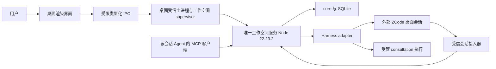

# RoleDock 桌面 GUI 分阶段开发计划

版本：0.3，依据 2026-10-25 最新代码重编。

状态：**规划文档，P6-G0–G7 尚未实施；本轮不开发 GUI、不重跑模型任务、不替代阶段验收。**

代码与文档基线：`d9743365256459a773a5319791cf3b7bb2e5fbe7`。运行时及测试已经提交，B5 系列材料由前序 `8bbf005` 入库，`d974336` 只补历史验收入口。规划期间不修改产品源码或历史验收报告。

决策依据：[ADR-0007](adr/0007-desktop-and-explicit-session-anchor.md)、[ADR-0009](adr/0009-trusted-connections-and-anchor.md)、[ADR-0011](adr/0011-human-authorization-entry-reservation.md)、[ADR-0012](adr/0012-adapter-enforced-isolation.md)。新增桌面编排和读模型提案见 [ADR-0013](adr/0013-desktop-orchestration-and-owner-views.md)。协议输入与生命周期以现有 Schema 和 [锚定规范](spec/external-session-anchor.md) 为准。

## 1. 本次重新规划的结论

P5-R、P5-A、G-min 和 P5-H B5-4 已有独立验收。最新 [B5-4 报告](phase-reports/P5-H-b5-4-review.md)明确裁定 **G01-Z03 关闭、P5-H 解除 BLOCKED、P5 整体通过，可以进入 P6-G**。旧计划中“真实宿主未选择”“锚定协议未实现”“必须先返工 P1–P5”的表述已过时，不再作为当前排期。

现在需要把已经验收的运行时做成可安装、可启动、可观察、可恢复的桌面产品。G-min 是一个真实可用的授权确认入口，完整桌面应用尚未形成；不能将它视为完整五页面或桌面安装包。

本计划把 P6-G 拆为 **G0 技术与契约 → G1 桌面生命周期 → G2 工作空间与角色 → G3 外部会话授权锚定 → G4 会话观察与恢复 → G5 角色知识 → G6 请求收件箱 → G7 产品验收与安装包**。每次执行一个子阶段，独立验收后继续。P6-R 发布准备在 G7 与 P6-G 总体验收通过后进行。

## 2. 产品边界与首版定义

用户通过 RoleDock 桌面 GUI 管理工作空间、角色、权限、外部会话绑定、知识与协作结果；聊天和模型执行仍属于外部 Harness。首个真实接入对象为用户已指定的 ZCode，首个支持平台为已验证的 Linux 环境。

首版不自建聊天 Harness，不复制私人聊天，不增加任意模型供应商配置中心，也不把角色 ID 或业务角色写入 core。CLI 保留作诊断和回归；最终主要流程不要求用户在终端敲命令、编辑 JSON、复制 bearer 或手工启动工作空间服务。

主导航保持五个工作区页面：**工作空间与连接、角色库、授权与会话、角色知识、请求收件箱**。诊断和应用设置为辅助入口，避免再建立另一套业务状态。

人类角色授权和 Agent 显式锚定必须区分。对当前 ZCode 接入，聊天内容或 realUser 标签不能证明真人授权；受信 GUI 确认写入事件后，受信通道执行 recordHuman，最后原会话 Agent 自行调用 sessions.anchor。今后若某宿主提供已验收的直接人类事件入口，可复用其证据，避免重复确认；首版不承诺 ZCode 单靠一句聊天文字就能签发授权。

### 首版必须完成的用户旅程

1. 双击启动应用，创建／打开工作空间，配置已有 ZCode 接入及受管请求执行所需的本地依赖；应用展示预检结果。
2. 在 GUI 安装任意本地声明式角色包，查看能力需求，并由所有者配置实际策略。
3. 用户在 ZCode 桌面打开原会话并表达任职意图；受信接入器识别和登记该原会话，GUI 展示可核对的宿主身份。
4. 用户在 GUI 确认角色、能力、initialize/takeover 意图和有效期；系统显示“事件已保存”“授权已生成”“等待 Agent 锚定”等实际进度。
5. 原会话 Agent 读取授权并显式锚定；载入确认和核心激活成功后，GUI 显示角色、代次、材料版本和实际权限。
6. Agent 在外部会话完成文档工作及独立协作。GUI 可以看知识修订、请求状态、真实答案、来源和收件箱；当前有权角色在外部会话显式采纳。
7. 新外部会话接任同一角色，旧主发布权失效；GUI 能看见继承关系、撤销和资源回收状态。
8. 关闭／重新启动桌面窗口、切换工作空间或恢复服务后，既有知识与绑定仍可核对，不重复任职或重复执行。

## 3. 当前实现盘点：哪些直接复用，哪些仍需建设

以下来自本轮源码静态核对与已存在的独立验收记录；不是本轮重新执行 449 项测试的声明。B5-4 独立验收记录为 42 文件、449 测试通过，真实八步链和十重叠请求有单独证据。

| 模块／源码位置 | 当前真实能力 | GUI 阶段的增量 |
| --- | --- | --- |
| `packages/core/src/sessions/anchor.ts`、`authorization.ts` | 外部会话登记、人类事件存储／读取、锚定、对账、绑定、撤销、到期、派生任务撤权与清理 | 复用状态与守卫；补所有者可查询的完整视图，不另写一套锚定状态机 |
| `packages/service/src/index.ts` | 单 writer、Unix socket、owner/trusted/session 三面、会话后台执行／维护 | 桌面启动／附着生命周期；分页读模型、运行诊断和必要的明确管理动作 |
| `packages/service/src/bin.ts` | 命令行只提供 `--mock-workspace`，可写 owner 连接文件 | 真实 ZCode 的可配置服务 launcher，不把 mock 启动当产品启动 |
| `packages/mcp/src/index.ts` | 14 个普通会话工具，身份固定、无管理员操作 | 复用启动与凭据注入；需要新收件箱／候选查询时先补会话白名单契约 |
| `packages/desktop/src/index.ts` | G-min：GET 页面、会话列表、角色列表、POST 授权确认；纯内嵌 HTML/JS | 模块化 UI、桌面窗口、导航、状态查询、错误恢复、浏览器点击测试 |
| `packages/desktop/src/bin.ts` | 读取属主／0600 校验后的 owner 文件，启动 loopback 确认页 | 无终端引导、原生目录选择、受限 IPC、工作空间 supervisor 和应用退出策略 |
| `adapters/zcode/src/index.ts` | 现有会话验证、材料确认／对账、真实结果、取消／关闭；受管构造声明 full，非受管保持 restricted | 真实桌面原会话与受管 consultation 的接入／路由验证；不扩大现有能力声明 |
| `adapters/zcode/src/reference-connector.ts`、`sandbox.ts` | 连接器 0.5.0、官方 app-server 桥接、受管进程与出口白名单、运行时状态验证 | 产品配置、依赖预检、断线与日志视图；不把个人测试路径打包为默认值 |
| `packages/core/src/admin.ts` | policy.show/grant/revoke、inbox 和 outbox 的概要诊断 | 请求／知识／绑定详情、分页与错误关联；当前概要不能支撑完整 GUI |
| 文档／候选／知识迁移服务 | 核心版本、权限、候选和导入导出机制已存在 | 所有者读取契约、文件选择、历史比较、候选查看；正式角色发布仍走会话面 |
| `packages/desktop/test/desktop.test.ts` | 3 个 HTTP／代理边界测试 | G-min 验收明确留下的真实浏览器点击流、桌面进程与打包回归 |

### 必须明确的四个代码缺口

- `externalSessions.list` 目前只有会话与有效授权摘要，不包含完整 binding、anchor attempt、load history、实际能力和回收进度；不能直接画完整生命周期图。
- owner RPC 当前没有通用文档历史、候选详情、请求详情、产物正文或角色连接代办接口；不能仅通过新增 UI 组件完成这些页面。
- 当前没有通用状态订阅接口。`admin.events` 是 outbox 概要，不是所有授权／绑定／宿主状态的事件总线。
- B5-4 真实八步链明确使用测试连接器中的主锚定会话。它证明既有协议与执行闭环，不替代“用户已在 ZCode 桌面打开的同一原会话”产品接入验证，也不是 GUI 点击验收。

## 4. 技术与架构方案

### 4.1 优先方案与 G0 决策门

优先技术验证 **Electron 外壳 + TypeScript 渲染界面 + 独立 Node 22.23.2 工作空间服务**。这是基于现有 TypeScript/Node 单仓库的工程判断，不是已经完成的选型或版本定档。Electron 的 main/renderer 进程划分和隔离桥适合映射现有受信进程／无凭据渲染层；其具体机制依据[官方进程模型](https://www.electronjs.org/docs/latest/tutorial/process-model)和[官方安全指引](https://www.electronjs.org/docs/latest/tutorial/security)。

G0 用一个可运行探针验证窗口、受限 IPC、服务子进程、SQLite、目录选择和打包；不得以文档选型替代探针。Tauri 作为备选，需要另外验证 Rust／Linux WebView 系统依赖与 Node sidecar 打包成本，依据[官方前置条件](https://tauri.app/start/prerequisites/)。G0 最终只保留一个容器和一套 UI 构建方案，避免同时维护两种桌面架构。

前端使用 TypeScript 模块和可测试组件；G0 决定是否引入单一 UI 框架、构建器与浏览器自动化依赖，并将精确版本、官方依据、系统依赖和锁文件更新写入 `docs/toolchain.md`。本规划不猜版本、不新增依赖。

**关键运行时约束**：Electron 自带的 Node 不自动等于 22.23.2。服务首选独立使用当前锁定运行时，安装包明确携带／声明该运行时。若改用外壳 Node 或其他打包运行时，须先更新工具链并验证 SQLite、子进程、MCP 和恢复矩阵，不能直接复用旧通过结论。

### 4.2 进程职责

桌面主进程只持有必要 owner 凭据，渲染器看不到 owner/trusted/session bearer、凭据辅助器输出或原始宿主日志。preload 只暴露具名方法，不提供任意 `rpc(operation,input)`、文件读写、Shell 或进程调用。

G-min 的确认输入校验、事件来源和服务调用可复用；其 HTML 内联脚本应拆分为可测试模块。角色标题、文档和模型输出视为内容，默认以文本或受限 Markdown 渲染，不执行包内脚本、原始 HTML 或远程资源。

### 4.3 服务与窗口生命周期

每个工作空间至多一个 `WorkspaceService`。首版优先一个前台活动工作空间，保留其他工作空间连接的后台状态；用户切换时不得隐式关闭仍被外部会话使用的服务。

| 动作／故障 | 规定行为 |
| --- | --- |
| 打开已有工作空间 | 先定位自身连接配置并验证 workspace_id；可以证明归属才附着；否则显示冲突，不抢锁 |
| 新建工作空间 | 选择明确目录，预检可写性、已有状态和依赖后启动；不递归清理用户目录 |
| 重复启动桌面应用 | 聚焦原窗口／附着原 supervisor，不启动第二个 writer |
| 关闭窗口 | 默认保留会话服务于后台；界面说明此行为，可再次打开；不等于 release/revoke |
| 退出应用／停止工作空间 | 若有进行中任务，说明影响，提供后台继续或明确停止；按既有撤权、取消、对账与清理语义执行 |
| 只附着外部已有服务 | 默认断开 UI 即可；不结束非本应用创建的进程 |
| 服务重启 | 旧 bearer 失效；受信组件重新登记原主体／宿主会话，恢复原绑定，不增加 generation |
| 服务或连接器异常退出 | UI 显示断线和最后刷新时间；查询／对账持久化动作，不以新 key 重放 |
| 模型调用未结束 | 显示等待／执行不确定，不把网络断开等同取消成功；回收只针对有归属记录的进程 |

具体后台托管方式在 G1 定档。不引入自动开机常驻作为首版必需项；托盘／后台能力如采用，必须在首个 Linux 目标环境实测。

## 5. 权限、查询与界面动作契约

### 5.1 已有入口与待补操作

下表“待补”均为计划，不是现有 RPC。G0 固化输入／输出／可见性，后续阶段实现时先补 Schema 和类型，再接 UI；不得把 UI 名称直接当作协议已支持的方法。

| 功能 | 已有可复用接口 | 待补契约／目标阶段 |
| --- | --- | --- |
| 工作空间识别 | `workspace.info` | 运行配置、服务健康、adapter/connector 版本、受管验证状态；G1/G2 |
| 角色安装／摘要／主指针 | `roles.install/list/resolve` | 角色详情与职责模板的只读展示；G2 |
| 策略 | `policy.show/grant/revoke` | 原子批量编辑或逐项状态回显；如批量需定义部分失败／事务边界；G2 |
| 真人授权确认 | `externalSessions.list`、`authorizations.submitHumanEvent` | 确认进度、事件→授权→绑定的关联视图；G3/G4 |
| 授权撤销 | owner `authorizations.revoke` | 撤销影响预览与回收状态，具体事件／审计关联；G4 |
| 绑定与载入对账 | session `sessions.binding/reconcile` | owner 分页只读 binding/attempt/load 列表／详情；G4 |
| 文档与候选 | session `documents.*`；owner `knowledge.export/import` | owner 文档列表／历史／正文／候选视图、受限文件选择；G5 |
| 请求与产物 | session `requests.*`、`artifacts.read`；owner `admin.inbox/events` | owner 请求／产物／预算／回收详情与分页；G6 |
| 角色读取收件箱 | 核心已有 `listInboxEntries` 等基础服务，当前 14 工具没有 inbox.list | 固定连接身份的会话收件箱／候选查询；需要时在 G6 补 SDK 映射、Schema、MCP 工具及权限测试 |
| 管理停止请求 | 目前只有发起会话 `requests.cancel`，owner 无对应 RPC | G6 评估并实现独立 owner 管理取消操作和审计；不传发起者 session_id 冒充取消 |

owner 新读模型建议按资源采用具名接口，至少包括 external session/binding/attempt、documents/revisions/candidates、requests/artifacts、runtime/cleanup。确切名字在 G0 写入契约清单，实施前不占用稳定协议名。

> **P6-G0 开发方定档（2026-10-25，待独立验收）**：首轮独立验收为 REWORK（2026-10-26，R01–R04，见 [phase-reports/P6-G0-review.md](phase-reports/P6-G0-review.md)），复验 PASS 前不得据此进入 G1。操作名、输入/输出要点、可见性矩阵与幂等规则见 [docs/spec/desktop-gui-contract.md](spec/desktop-gui-contract.md)（v2 返工修订）；技术选型与精确版本见 `docs/toolchain.md`「P6-G0 桌面技术定档」与 ADR-0013。

### 5.2 可见性与写入边界

- 所有者可见的管理数据必须经过服务明确投影和脱敏，不能返回整张数据库或任意 object store 文件。private/role 文档正文的 owner 可见性须在 G0 写成矩阵；首版默认只展示明确允许的可分享正文，其余只显示许可范围内元数据。
- 工作空间权限、角色授权、主实例身份是三个检查层。GUI 不能把 `requested_capabilities` 勾选结果直接当作实际策略授权。
- GUI 编辑以本地草稿或 owner 来源的候选提交为界。若新增 owner 候选提议，来源和审计须区别于角色 `documents.propose`，且不能因此获得 `documents.publish` 权限。
- **正式发布和结果采纳仍由当前角色主实例完成。** GUI 可以比较、标出冲突并提供转到原会话／复制结果引用的动作；不得以 owner 凭据转借 session 身份。页面显示“待角色采纳”，不能在点击建议后显示“已发布”。
- `requests.reply` 由原发起会话执行；首版 GUI 只展示需要补充的信息和返回原会话入口，不建立另一套聊天。
- 释放绑定仅由原会话 `sessions.release`；owner 可走明确授权撤销。继承后的 superseded、撤销 revoked、释放 released 和到期 expired 分开显示，不能统一成“离线”。

### 5.3 查询一致性与操作反馈

首版采用有界轮询：活动页建议 1–2 秒刷新一次，后台视图 5–15 秒，隐藏页暂停；这些是 G4 的性能验证目标，不是当前实现承诺。长宿主动作以 operation/attempt ID 查询，不长时间占用无超时界面请求。

新读模型返回 `workspace_id`、`observed_at`、分页游标及相应对象版本／修订。owner 读视图应来自同一协调器的一致读取，跨多个 RPC 拼装时明确显示观察时间差。切换工作空间／筛选后丢弃旧响应，不让迟到数据覆盖新页面。

写请求使用稳定 action ID／幂等键；按钮提交时禁止重复点击，超时后先查状态再重试。现有 RPC 未实现通用写幂等，新增 GUI 写入口须逐项定义，不得宣称全部操作天然幂等。授权确认要处理“人类事件已存储但授权尚未生成”的窗口，不能只凭 active_authorization=null 再写一条相同事件。

## 6. 页面、信息架构与状态设计

| 页面 | 核心内容与动作 | 特别需要防止的误导 |
| --- | --- | --- |
| 工作空间与连接 | 最近目录、新建／打开、预检、版本、服务启停、连接器／helper 配置、受管状态、诊断 | “已连接”不等于“所有隔离能力已验证”；mock 与真实接入清楚区分 |
| 角色库 | 包安装、职责／文档模板／输出 Schema、版本哈希、需求和实际策略、当前主代次 | `initialized` 仅表示已有代次，不能等价于有可服务主实例；结合 current_instance_id 和有效 binding |
| 授权与会话 | 当前原会话身份、授权范围／来源／到期、确认进度、锚定／载入／代次、继承关系、撤销 | 确认不是绑定；takeover 不是普通刷新；旧会话不会自动变成新角色 |
| 角色知识 | 文档目录、当前／历史、来源与可见性、修订比较、checkpoint 摘要／待办、候选、导入导出 | 草稿／候选不是正式知识；导出不携带权限或私人聊天；冲突不丢编辑 |
| 请求收件箱 | 发起／目标、接收代次与快照、问题、期限与已报告用量、产物、候选、回收状态 | 已取消不等于宿主已经终止；结果完成不等于已采纳；报告缺失的用量显示未知 |

所有页面具备加载、空、错误、断线、过期数据和无权限状态。中文为首版默认；标识可复制，技术细节折叠为来源／诊断，不要求用户理解 bearer、CAS 或底层 SQL。

授权和接任表单显示人能判断的影响：目标角色、当前主会话、要接任的新会话、能力增减、有效期、当前未完成任务可能受到的影响。具体有效授权不反复确认；新增接任、扩大权限、撤销等新的用户决定在对应按钮处作出。

键盘可访问、可见焦点、非颜色唯一状态提示、合理对比度、长文本换行与 1280×800 布局纳入验收。主列表分页／限量，文档与产物按需读取；不在初次加载时拉取所有正文。

## 7. 总阶段、里程碑与依赖

| 子阶段 | 目标 | 估算人日 | 前置 | 开发入口 |
| --- | --- | --- | --- | --- |
| P6-G0 | 代码能力／查询契约定档、桌面技术探针 | 2–3 | B5-4 PASS | [06G0-contract-and-spike](../prompts/06G0-contract-and-spike.md) |
| P6-G1 | 桌面外壳、IPC、唯一服务与进程生命周期 | 3–5 | G0 PASS | [06G1-shell-and-runtime](../prompts/06G1-shell-and-runtime.md) |
| P6-G2 | 工作空间／真实接入预检、角色库与策略 | 3–4 | G1 PASS | [06G2-workspaces-and-roles](../prompts/06G2-workspaces-and-roles.md) |
| P6-G3 | 原 ZCode 桌面会话、人类确认与 Agent 锚定 | 4–6 | G2 PASS | [06G3-session-authorization](../prompts/06G3-session-authorization.md) |
| P6-G4 | 会话详情、代次时间线、撤销与恢复观察 | 2–3 | G3 PASS | [06G4-session-observability](../prompts/06G4-session-observability.md) |
| P6-G5 | 知识、历史、候选与迁移界面 | 3–4 | G4 PASS | [06G5-knowledge](../prompts/06G5-knowledge.md) |
| P6-G6 | 请求、结果、收件箱与控制边界 | 3–5 | G5 PASS | [06G6-requests-and-inbox](../prompts/06G6-requests-and-inbox.md) |
| P6-G7 | 桌面全链、恢复、可用性和安装包验收 | 4–6 | G6 PASS | [06G7-release-validation](../prompts/06G7-release-validation.md) |
| P6-R | 开源候选材料与发布准备 | 2–3 | G7＋P6-G 总体验收 PASS | [06-open-source-candidate](../prompts/06-open-source-candidate.md) |

估算为一名熟悉该仓库的开发者 **26–39 人日，约 5–8 人周**，含阶段内验证和文档，不含独立验收等待、外部宿主接口变更或用户配置等待。G0 探针后更新估算，不能用这一估算承诺具体交付日期。

里程碑 M1＝G0–G3：可以从桌面安装角色并让真实外部原会话锚定。M2＝G4–G6：五页面业务闭环。M3＝G7：可安装、可恢复的 Linux 桌面候选。只有 M3 及 P6-G 总体验收通过才能转 P6-R。

G-min 已交付，不重新排期。cgroup CPU／内存／pids 上限在既有验收中为可选加固项，不把它重新设为 P6-G 的硬门槛；界面如未检测到上限，应准确显示“未配置”，不能显示“资源无限隔离”。Windows/macOS、插件市场、自动更新、云端同步、向量检索和角色包升级／卸载等无既有契约的功能延后。

## 8. P6-G0：技术探针和契约定档

**输入**：本计划、ADR-0013、现有 desktop/service/mcp/zcode 源码、G-min 与 B5-4 独立验收、工具链。

**工作**：

1. 冻结实际提交／工作区基线，生成“已有／缺失／计划”能力清单和页面动作到 principal/RPC 的映射。先完成 owner 可见性、管理取消、候选提交、敏感字段与每项写入幂等规则的决策。
2. 用一个窗口技术探针验证具名 IPC、目录选择、Node 22.23.2 服务启动和关闭、SQLite、MCP 子进程、打包后资源路径。探针采用临时 mock 工作空间，不花真实模型额度。
3. 明确 main/preload/renderer/runtime 目录与构建边界。建议继续扩展 `packages/desktop`，不复制 core。若 supervisor 有跨包复用需要，先记录理由再新增可运行包。
4. 固化 owner 读模型的契约清单、分页／脱敏／错误结构；状态变更操作先扩展 Schema，普通会话仍无 owner 权限。查询不导致授权到期之外的额外状态动作。
5. 定档容器、UI 方案、E2E 工具、运行时与构建／打包依赖精确版本及官方资料；更新 toolchain 和 ADR。给出 `.deb` 首选候选与解压即跑开发产物的可行性结论，最终只维护一个首发 Linux 安装格式。

**退出条件**：探针在本机真实窗口／进程可运行；不泄漏凭据；服务不重复持锁；打包探针能定位运行时；契约表没有依赖不存在 RPC 的页面承诺。独立验收只裁定 G0，不视为完整 GUI 通过。

**交付**：技术探针、ADR 最终决策、精确工具链、GUI API 契约、能力／动作映射、G0 开发报告及复现日志。**不做**五页面和真实模型演示。

## 9. P6-G1：桌面外壳和运行生命周期

**工作**：模块化现有 G-min，建立导航壳、错误边界、工作空间 supervisor、具名 IPC、原生文件／目录对话框和基础设置；实现进程归属、服务启动／附着、重复应用启动处理、后台／退出策略与重连。

独立 Node 服务使用结构化参数，路径不经拼接 Shell。owner 连接只在受信层保存；所有目录和工作空间切换需与服务 workspace_id 对应。生产渲染层关闭 Node 集成、保持上下文隔离／沙箱、校验 IPC 调用来源；不暴露通用执行桥。G-min loopback 诊断入口如保留，须与桌面生产入口明确区分访问边界，不能作为无限制 owner RPC 代理。

当前 `ServiceClient.call` 没有显式客户端超时参数，service.close 会等待 worker。G1 必须补请求等待期限及有界停机策略：取消界面等待不等于取消已提交动作，停机等待用尽后保留执行／回收不确定状态，恢复时对账，不能为快速退出丢弃持久意图。

**验证**：重复开两窗口只一个 writer；关闭窗口不撤销原绑定；重启 UI 附着原服务；SIGTERM／异常退出后清理自身端点和进程；错误／外来 socket、错误 owner 文件及未经授权 IPC 拒绝；空工作空间可从安装探针打开。

**退出条件**：开发版能从一个桌面入口打开管理窗口并启动／附着 mock 服务，不需手输 owner 文件；重连与单 writer 断言通过。**不做**真实接入配置、授权业务扩展或其他页面。

## 10. P6-G2：工作空间、接入预检、角色和策略

**工作**：

- 创建／打开／最近工作空间，分别保存应用设置与工作空间状态；移除最近记录不删除实际项目。持锁、不可写、路径失效等错误提供具体恢复动作。
- 配置 ZCode CLI 路径、连接器、已授权 credential helper 引用、模型标识及受管出口集合。使用可核验配置，不扫描或解密账户私密存储，不在 renderer 显示 helper 输出。
- 实现真实服务 launcher：注入对应 adapter、工作空间人类事件 source 和后台 worker，处理初始化依赖，替代仅有 mock bin 的产品缺口。
- 预检 Node、CLI、connector 工具、bwrap／内核能力、目录和白名单；普通预检仅查询，不创建会话或消费模型轮次。“运行真实连接测试”作为用户单独动作，说明可能支出。
- 角色包原生目录选择／安装、角色列表和职责详情、哈希版本、实际主状态、需求与策略对照；默认不授予角色包所有请求能力。策略变化回读，部分失败不伪装整批成功。

**验证**：任意 custom-role 无需改 core；同包幂等、冲突、无效包、取消选择、受限依赖均正确显示；选择角色不打开会话；策略撤销后下一次角色动作按核心拒绝；空／非空目录和两个工作空间不会串数据。

**退出条件**：用户从 GUI 创建真实配置的工作空间并安装角色、设置策略，启动步骤无需 CLI。缺 helper／依赖时如实受限。**不做**授权确认和模型锚定演示，留 G3。

## 11. P6-G3：原会话接入、人类确认与显式锚定

本阶段是产品关键路径；不能用测试脚本里的新建主会话代替原 ZCode 桌面会话。

**工作**：

1. 接入器识别用户正在使用的原会话和受信主体，经 `externalSessions.register` 注册并将该会话 bearer 只交给其工具启动器。已有连接器能够验证什么，必须按真实桌面会话实测，不能由模型填 host ID 就视为接入。
2. 若主桌面会话通道与受管 consultation 执行需分离，在 adapter/launcher 层实现可审计路由和归属检查；明确 adapter 能力与受管状态的关联。无法接入原桌面会话时记录产品集成阻塞，不悄悄新建另一个聊天，也不回退非受管请求执行。
3. 复用 G-min 确认表单，增加当前主实例、initialize/takeover、能力差异、有效期和来源预览。已接任或已释放的旧会话不允许原地换角色。拒绝仍是“不确认／无写入”；若需要持久化拒绝，先定义协议，不虚构记录。
4. GUI 提交人类事件；受信接入器关联 event_ref 并自动完成 recordHuman。当前 owner/trusted 面没有“待登记人类事件通知”完整产品桥，须在本阶段补受信查询／进度机制，严格绑定主体与会话，不开放给模型签发。
5. Agent 在外部原会话调用 `authorizations.get`、`sessions.anchor`；GUI 只观察。事件保存、授权生成、等待 Agent、loading、uncertain、active/failed 分开展示。需要用户回到原会话继续时给清晰提示，不由 GUI 调 anchor 冒充 Agent。
6. 不支持宿主深链接时提供复制非敏感会话引用与操作提示；支持时验证允许的链接目标。记录材料哈希、确认版本、当前代次，重试复用原 attempt/load key。

**验证**：真实浏览器／桌面点击“确认”一次，原会话成为目标角色；并发双击／刷新／窗口重开不生成重复有效授权或下一代；模型自述、跨会话、超范围、失效授权拒绝；知识漂移／代次竞争按既有语义呈现。

**退出条件**：留下真实 ZCode 桌面原会话 ID 前后一致、GUI 点击、受信事件、授权、Agent 工具调用、载入确认、active binding 的关联证据；在正式角色工作前完成载入。G-min 报告遗留的浏览器点击证据在此补齐。**不做**自动读取私人聊天或自动接任下一主实例。

## 12. P6-G4：会话观察、撤销与恢复

**工作**：补 owner binding/attempt/load 只读视图；以时间线展示角色 generation、前任、knowledge_revision、来源、有效能力、载入确认和不确定原因。连接可用性与角色有效性分别显示，避免断线就撤销或 expired 仍显示 active。

支持 owner 撤销及影响预览；释放保留原会话操作；用户在原会话执行 reconcile 后 GUI 自动刷新。若增加 owner 对账控制，须独立契约、重检主体与原动作，只允许查询／续接已有持久意图，不能重建任职。策略／授权变化实时反映到有效能力；展示 cleanup_pending 和 execution_uncertain，不将“撤销已生效”写成“外部进程已结束”。

**验证**：takeover 后旧实例 superseded、新实例 active；撤销／释放／到期派生任务按照 ADR-0009 撤权，迟到结果拒收；仅 takeover 的已接收请求继续保持旧快照；服务重启重新登记后恢复原绑定且代次不变；陈旧响应不覆盖切换后的工作空间。

**退出条件**：用户能解释某会话现在是否有权工作、为何失败、应回哪一会话恢复；无需查看 SQLite。状态数据有观察时间和分页。**不做**全聊天历史浏览器或通用事件总线。

## 13. P6-G5：知识、候选与迁移

**工作**：文档目录／正文／历史修订比较、可见性与来源、checkpoint 摘要／待办，候选原始基线／当前基线／来源比较，导出／导入原生选择与结果清单。新增 owner 读接口按 G0 确定的可见性矩阵投影；UI 不读取 objectPath 或直接开库。

导入沿用核心流程，显示“已创建候选”，不自动采纳或发布；导出范围默认可分享材料。大正文按需读取和限制渲染开销；不把导出文件外部修改当成正式知识更新。编辑保存本地草稿；需要提交 owner 候选时新增明确 owner 提议契约和审计，不伪造角色提案。

正式发布／采纳在外部当前主角色会话执行；GUI 提供目标、候选／产物引用、版本冲突说明及回到原会话动作。若本轮不实施 owner 候选提交，首版明确显示“本地草稿”，仍可通过现有导入流程提交候选，不能出现空功能按钮。

**验证**：历史不可变、过期基线冲突不丢正文、撤权后的旧页面不能继续操作；private/role 内容按既定矩阵展示；知识包哈希／来源／越界验证仍有效；导出包无凭据／私人聊天；两个工作空间迁移后是候选而非静默发布。

**退出条件**：用户可在 GUI 完成知识查看、比较和迁移，并看到当前主角色外部显式发布后的新修订。**不做**富文本协同、全文向量搜索或角色包静默升级。

## 14. P6-G6：请求、产物与收件箱

**工作**：请求列表／详情、发起者和目标、接收代次与快照、预算期限和已报告用量、澄清状态、真实产物正文／哈希、候选基线、inbox unread/read 与清理状态；补 owner 有界读视图和按角色／状态／时间筛选。

保留“外部 Agent 发起请求”主流程。需要补充输入时，引导原发起会话调用 requests.reply。若实现 GUI 管理取消，使用独立 owner 操作、审计和终态守卫；不挪用发起 session。终态不可再次取消／重试执行，执行不确定先对账。未来创建新请求必须是新用户／Agent 意图，不是“刷新失败项”。

补齐固定会话身份的收件箱／候选读取工具，使当前角色在正常工作轮次可取待归并材料。GUI 的“建议采纳／打开原会话”动作不发布正文；最终由该主角色执行 `documents.publish(adopt_artifact_id)`，随后 GUI 显示 adopted 和确切修订。请求终态、inbox 已读、候选采纳是不同维度。

**验证**：十个真实重叠请求的 GUI 列表与后端逐项对应；独立宿主／结果／权限作用域、零主会话注入；取消／到期／超预算后的产物不采纳；新主实例对旧代次结果的冲突如实显示；完成和清理失败可区分；UI 不阻塞角色继续工作。

**退出条件**：在 GUI 看见从接收、执行到真实答案和显式采纳的全链，不需 admin CLI。已知缺失用量显示未知，不以0代替。**不做**任务 DAG、嵌套自动请求、后台向用户主聊天注入任务。

## 15. P6-G7：桌面体验、恢复和安装包收口

**工作**：将 G0–G6 集成到单个 Linux 桌面产物；完成打包、运行时／资源定位、首次启动、依赖诊断、重启和故障恢复、可访问性、性能基线、通用角色演示与用户文档。安装包携带自身 UI、服务、连接器等必要文件；ZCode 本体、用户账户和系统 runner 的依赖方式明确，不能打包当前个人账户或测试 helper。

选择 G0 已定档的首发 Linux 安装格式，在没有仓库 node_modules 的环境安装运行。系统缺 bwrap/userns/CLI/helper 时显示明确缺项并拒绝受管任务；普通界面仍能打开，不能偷偷加 `--no-sandbox` 或将非受管路径标 full 来凑演示成功。

### 总体验收矩阵

| 编号 | 场景 | 必须证据 |
| --- | --- | --- |
| GUI-01 | 安装后启动和工作空间打开 | 真正桌面窗口；无需 npm/nvm/终端；已声明外部依赖有可执行指引 |
| GUI-02 | 多窗口／重复启动／附着 | 一个 writer；无抢锁、端点覆盖或跨空间状态泄漏 |
| GUI-03 | 角色与策略 | demo-team 和 custom-role 可安装；权限需求和实际 grants 分离 |
| GUI-04 | 原 ZCode 桌面会话锚定 | 原 host ID 一致；GUI 点击→人类事件→recordHuman→Agent anchor→载入确认→active |
| GUI-05 | 状态与生命周期 | 事件／授权／绑定分离；superseded/released/revoked/expired/uncertain 可辨认 |
| GUI-06 | 继承与发布 | generation 单调；旧主拒绝发布；恢复不加代次；已提交摘要／待办保留 |
| GUI-07 | 角色知识 | 历史／来源／可见性可核对；候选／草稿不假报正式发布；冲突内容保留 |
| GUI-08 | 受管请求 | 至少10实际重叠；GUI与后端一一对应；独立结果、零主会话注入 |
| GUI-09 | 撤销、取消与迟到 | 权限立即失效；终态不复活；外部清理尚未确认有明确标记 |
| GUI-10 | 结果采纳 | 真实正文／哈希；当前有权主角色显式采纳产生确切文档修订 |
| GUI-11 | 异常退出与恢复 | UI、service、connector 分别中止后可恢复或明确待对账，不重复执行 |
| GUI-12 | 渲染与身份边界 | 无 bearer/写库/任意 RPC；不执行原始 HTML；owner 和会话操作不混用 |
| GUI-13 | 可用性与性能 | 键盘、焦点、错误／空状态和目标分辨率；分页、大正文和轮询无明显冻结 |
| GUI-14 | 安装／升级／移除 | 无源码依赖；版本变化先检查迁移；移除应用默认保留用户工作空间 |

性能先以固定数据量验证：建议角色50、外部会话200、请求1000、文档修订1000作为界面造数集，列表页大小50；本地查询／页面交互以 p95≤500ms 为初始目标，观测页面状态更新≤3s，模型耗时另计。G0/G4 可据基线调整目标并记录依据，不能宣称当前已达到这些容量或指标。CPU、内存、安装体积与启动时间记录实测，不臆造预算达标。

**退出条件**：上述矩阵逐项有真实断言／操作证据，原 `npm run check` 与新增桌面／E2E／打包检查通过。GUI 点击与实际桌面主会话证据不能由 HTTP 直调或 fixture 代替；测试环境与真实模型验证分别报告。P6-G 总体验收 PASS 后形成 P6-R 输入，不自动远程发布。

## 16. 验证、报告和变更管理

每个子阶段报告为 `docs/phase-reports/P6-Gn-development.md`，状态“待独立验收”；对应 `P6-Gn-review.md` 由独立验收 Agent 按 [REVIEW](../prompts/REVIEW.md)执行。G7 同时产出 P6-G 总体对照和验收入口；G-min 历史报告保持原样。

每阶段记录实际 HEAD 与工作区差异、契约变更、运行命令、退出码、失败／跳过／未验证项和证据路径。证据目录建议 `docs/phase-reports/evidence/YYYY-MM-DD-p6-gn/`；截图／录像、浏览器轨迹、应用日志和后端 ID 应能关联，收集时遮蔽凭据和无关私人聊天。

验证按风险增加：查询契约与身份边界用服务集成测试，窗口／单 writer／进程恢复用实际进程测试，页面操作用真实浏览器／桌面测试，最终在真实 ZCode 桌面会话验证。真实模型只在相关接入阶段与收口必要回归中运行；布局或文本改动不重复消费全链模型额度。

日常复用现有 `npm run build/typecheck/check`。G0 选定后新增桌面开发、E2E和打包命令；这些命令当前不存在，不能在本计划中写成已可运行。依赖和运行时更新先改 toolchain，架构和权限面调整先补 ADR，不重写历史验收结论。

## 17. 风险、范围决策与下一步

| 风险／取舍 | 解决阶段与措施 |
| --- | --- |
| 测试连接器主会话与真正桌面原会话差异 | G3 专门做产品接入验证，必要时明确拆分接入／受管执行通道；失败阻塞本阶段，不新建假主聊天 |
| owner API 不足导致直接查库／冒充角色 | G0 契约清单，G4–G6 增量服务投影；发布始终由现有当前角色权限校验 |
| 授权确认后无人推进 recordHuman／Agent 不锚定 | G3 补受信事件进度桥；显示等待谁执行，不把中间步骤假报完成 |
| 容器内置 Node 与 SQLite 运行时不同 | G0 探针定档，优先独立固定 Node 服务，实际打包验证 |
| 服务关闭影响外部活跃会话 | G1 明确后台／停止策略和进程归属，G7 验证异常退出与重连 |
| 个人 helper、固定 /opt 或 /tmp 路径进入安装包 | G2 配置与校验、G7干净环境验证；测试材料不充当生产启动器 |
| 将 Linux 已验证能力外推跨平台 | 首版只声明验证过的 Linux 组合，其他平台单独立项 |
| 449 项旧测试被误当 GUI 完成证据 | 只作为既有验收基线；新增 GUI、浏览器、原桌面会话与打包证据独立建立 |

**当前可执行的下一步仅为 P6-G0。** 先固定技术运行探针、owner 查询契约和产品接入路线，再实施外壳与页面。既有 B5-4 通过结论保留，本轮更新只重编计划与入口文档，不开发产品、不修改运行时能力声明、不自动提交或发布。
