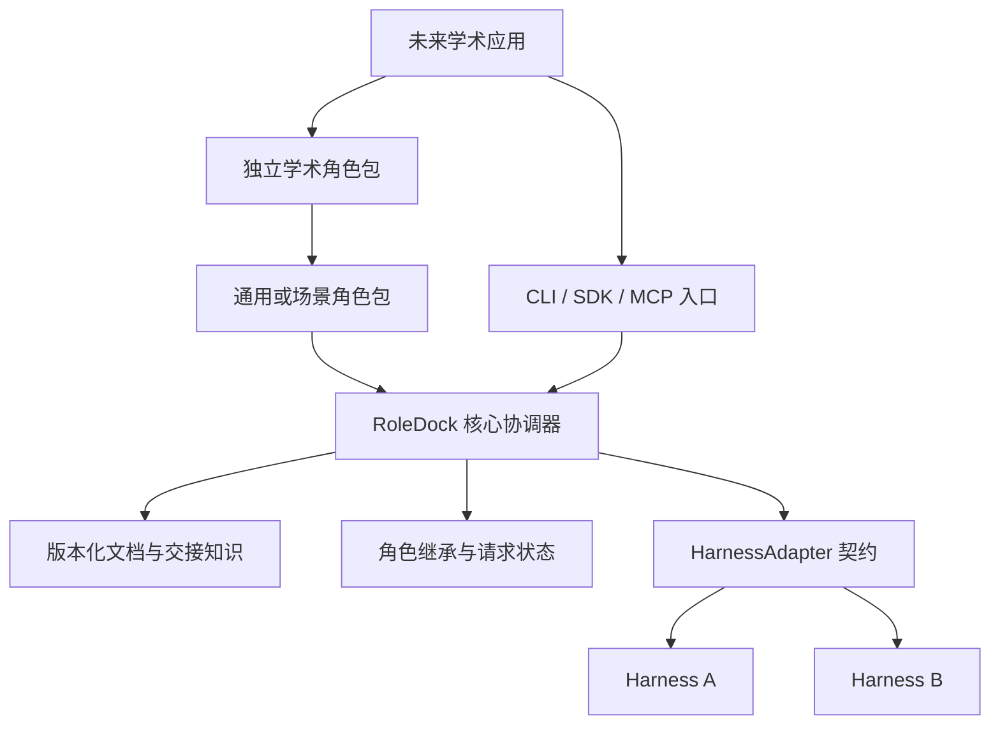

# RoleDock：通用 Agent 角色框架原型开发计划

版本：0.1 开发蓝图  
日期：2026-10-12  
目标：独立开源通用基础框架，为后续学术场景提供可复用的角色与协作基础。

## 1. 项目命名与定位

项目名称拟定为 **RoleDock**，中文名 **角色坞**，仓库名与 CLI 名拟用 `roledock`。

Role 表示可长期持续的职责身份，Dock 表示角色接入不同 Harness 的统一位置。名称对应两个产品承诺：角色知识持续积累，会话可按明确状态接续。

一句话介绍：**一个支持自定义 Agent 角色、文档化知识、会话继承和独立协作请求的通用协议框架。**

英文介绍：**A framework for persistent agent roles, document-based knowledge, session handoff, and isolated collaboration across harnesses.**

本轮对候选名进行了公开检索。RoleWeave 已有同类开源项目，RoleLoom、RoleRelay、RolePort 也有公开使用记录；RoleDock 未检索到明显同名 Agent 框架。该结果仅作为命名选择依据，仓库及包注册情况在 P0 核查，不把检索结果当作名称已经取得。

独立开源的交付范围为协议规范、参考运行时、SDK、CLI、适配契约、通用示例、测试与文档。RoleDock 核心可以单独安装、运行、演示和发布。

## 2. 从场景方案提炼出的通用抽象

上一版方案中的六类角色属于具体应用层。RoleDock 核心接受任意角色标识和职责定义，不固定角色数量，也不要求角色必须是工程、文献或学术角色。

| 原场景能力 | 通用框架抽象 | 后续场景实现 |
| --- | --- | --- |
| 工程、方案、向导等角色 | RoleDefinition 与 RolePackage | 不同角色的职责和提示模板 |
| 每个 Agent 的维护文档 | DocumentStore 与角色所有权 | 开发记录、FAQ、文献笔记等模板 |
| 新会话继承旧 Agent | RoleHead、Checkpoint 与 Handoff | 场景定义哪些知识进入交接摘要 |
| 文档不足时请求其他 Agent | CollaborationRequest 与文档读取记录 | 验收、解释、讨论、分析等请求类型 |
| 请求不干扰其他会话 | 独立 Session 与请求作用域 | 按任务要求配置执行空间 |
| 项目成果验收 | 输出 Schema 与应用层流程 | 工程验收或实验审查插件 |
| 定期文献挖掘 | 后续通用触发器扩展点 | 学术应用提供检索源和调度逻辑 |

核心只解释通用对象与状态；职责内容、知识模板、输出结构和业务流程由角色包或应用提供。角色包中的 `reviewer` 等名称只用于示例，不影响框架权限和路由判断。

## 3. 原型范围与最短验证路径

### 3.1 v0.1 必须完成的五项能力

1. **角色包接入：** 从本地声明式文件安装角色包，注册任意角色及文档／输出模板，版本固定并可验证。
2. **版本化文档：** 所有者发布文档，其他角色按权限读取并提出候选更新，发布检查版本和角色代次。
3. **主会话继承：** 创建角色主会话时自动导入交接包，再原子切换当前继承者；旧实例失去正式发布权。
4. **独立协作请求：** 先读必要文档，再按稳定角色身份请求，接收时绑定最新继承者并创建独立分支。
5. **Harness 适配：** 用公开接口创建独立会话、载入 BootstrapBundle、执行任务与读取结果，支持显式能力降级。

第一版采用本地单协调器、SQLite 状态存储、内容哈希产出目录、TypeScript SDK 和 CLI。公共调用以 SDK 为基础，CLI 支持机器可读 JSON；MCP 提供工具与资源入口。HTTP 服务、远程 A2A 服务、多节点存储和原生会话分支作为后续能力。

### 3.2 原型演示

安装一个三角色示例包：`builder`、`reviewer`、`explainer`。这三个角色只是演示职责，用户可以替换为自己的名称和说明。

演示必须能从干净状态完成：

1. 创建 builder 主会话，发布一份带版本的状态文档和交接摘要。
2. explainer 读取文档；仍有疑问时创建到 builder 的独立请求。
3. 两个并发请求具有不同会话与结果空间，builder 用户主会话不收到注入消息。
4. 创建 builder 新主会话，继承已提交知识并成为下一代。
5. 后续请求绑定新代次，原请求保留旧快照；旧主实例发布被拒绝。
6. 导出角色知识，用第二个适配器导入并恢复；不复制私密聊天或模型隐藏状态。
7. 加载一个名字与职责都不同的自定义角色，核心代码无需修改。

原型成功以状态行为和真实适配链路为准，模型回答是否精彩不能代替这些验收条件。

### 3.3 延后范围

首版不实现学术专用对象、论文检索、周期调度、GUI、向量数据库、插件市场、组织层级、复杂任务图或多协调器一致性。开发验收工作流在示例应用中实现，不进入通用核心状态机。

## 4. 角色包契约

角色包是职责、文档模板和输出 Schema 的声明式集合。原型只加载本地文件，不执行角色包中的脚本；工具调用仍通过 Harness 及其授权机制完成。

示例结构：

```text
rolepack/
  rolepack.json
  roles/
    builder.md
    reviewer.md
    explainer.md
  templates/
    state.md
    decisions.md
    handoff.md
  schemas/
    review-result.json
```

以下为拟定格式，P0 需要固化 JSON Schema：

```json
{
  "schema_version": "0.1",
  "name": "demo-team",
  "version": "0.1.0",
  "requires_protocol": "0.1",
  "roles": [
    {
      "id": "builder",
      "title": "构建者",
      "instructions": "roles/builder.md",
      "documents": [
        {
          "key": "state",
          "template": "templates/state.md",
          "visibility": "project"
        },
        {
          "key": "handoff",
          "template": "templates/handoff.md",
          "visibility": "role"
        }
      ],
      "output_schemas": [],
      "requested_capabilities": [
        "documents.read",
        "documents.propose",
        "documents.publish",
        "requests.create"
      ]
    }
  ]
}
```

示例只展开一个角色，完整示例包包含三个角色。`requested_capabilities` 是权限需求声明，不是授权凭据；项目所有者的策略决定实际权限。发布权还必须满足文档所有权、当前主实例身份和基线版本要求。

包路径需限制在包根目录内，拒绝路径穿越和越界符号链接；原型输出 Schema 使用受限的本地引用，禁止运行时从未知远程位置加载。包版本及内容哈希进入会话 BootstrapBundle 和审计记录。更新包不静默改变正在运行会话的契约，按显式升级与交接生效。

## 5. 核心状态与行为约束

### 5.1 最小对象

| 对象 | 关键内容 |
| --- | --- |
| Workspace | 工作空间身份、配置及权限策略 |
| RoleDefinition | 包版本、角色 ID、职责、模板、能力需求 |
| RoleHead | 角色当前实例、generation、knowledge_revision |
| AgentInstance | 任职身份、前任、角色契约版本及状态 |
| Session | 宿主会话映射、kind、adapter、执行状态 |
| DocumentRevision | 所有者、文档键、版本、正文哈希及可见性 |
| Checkpoint | 文档快照、交接摘要、用户决策引用、待办与来源 |
| CollaborationRequest | 发起会话、目标角色、绑定代次、快照、预算及状态 |
| ArtifactRef／CandidateUpdate | 结果标识、内容哈希、来源及归并基线 |

唯一主指针键为 `(workspace_id, role_id)`。角色 ID 采用包内定义，安装到工作空间后必须唯一；冲突要显式命名或拒绝，不能静默覆盖。

### 5.2 必须保持的约束

- 一个角色只有一个正式主指针；请求分支永远不替换主指针。
- 正式发布校验当前实例、generation、文档所有权和 expected_revision。
- 发布文档或交接摘要时增加角色 knowledge_revision，防止交接准备期间漏掉新知识。
- 交接包及文档版本不可变；主指针切换通过事务中的比较并交换完成。
- 新请求在接收事务内固定目标代次与知识快照；运行中和已排队请求不自动迁移。
- 主会话不接受咨询请求消息注入；归并候选进入收件箱，在正常主会话工作轮次读取。
- 请求和文档动作由受信会话身份调用，客户端传入 role_id 不能自行取得角色权限。
- 隔离至少覆盖上下文、临时写入、结果与能力作用域；执行隔离不足时明确拒绝相关任务。
- 数据库状态为实时权威来源；Markdown 导出是带版本材料，外部编辑通过候选导入归并。
- 权限、密钥、活跃进程和模型隐藏状态不作为可迁移知识。

### 5.3 继承流程

`prepare → provision → activate → retire`：读取旧代次和 knowledge_revision；形成不可变 BootstrapBundle；创建新宿主会话并确认载入；事务中校验基线并激活；使旧实例失去发布权。

准备或创建失败保持旧主指针。并发激活只允许一个成功。若准备期间知识变更，重新准备，不把最新文档与旧交接摘要混成无来源的状态。交接摘要的完备性通过引用、更新时间和待办登记帮助用户判断，框架不保证模型总结永远无遗漏。

首次打开角色可自动初始化首个主实例；协作请求没有目标主实例时返回 `ROLE_UNINITIALIZED`，由显式打开角色完成初始化。恢复已有会话不等于继承，不增加代次。

### 5.4 请求流程

读取记录 → 请求接收与绑定 → 排队 → 独立会话创建 → 执行／内部澄清 → 结果登记 → 终态与回收。请求前需提供本会话真实文档读取记录及信息缺口；无文档或不可读时填写可验证的例外理由。

状态至少为 `accepted`、`queued`、`running`、`awaiting_input`、`completed`、`failed`、`cancelled`、`expired`。终态不能再次转为运行或发布结果；创建状态不明时使用 `execution_uncertain` 子状态，不直接重试有副作用的执行。

相同幂等键和相同内容返回原请求；同键不同内容报冲突。原型默认禁止嵌套自动请求，避免先实现递归预算分配；未来增加时需要共享总预算与调用链检测。

### 5.5 对外接口草案

SDK 操作包括 `roles.install/list/resolve`、`sessions.open/resume`、`documents.list/read/propose/publish`、`handoffs.prepare/activate`、`requests.create/get/reply/cancel`、`artifacts.read`、`knowledge.export/import`。

每项写入在 P0 指定输入 Schema、调用身份、幂等规则、事务边界、错误码和返回结构。框架操作不是 MCP、ACP 或 A2A 的原生方法；协议绑定负责映射，不能混用标准能力字段。

## 6. 架构、适配与场景独立性



核心使用端口接口访问存储、会话执行和产出空间，不直接调用具体模型 API，也不硬编码角色名称。原型使用一个协调器进程写入每个工作空间，数据库事务和待投递记录衔接外部执行。

HarnessAdapter 至少有 `getCapabilities`、`createSession`、`runTurn`、`getResult` 和 `closeSession`；`cancel`、`lookupSessionByCreationKey`、`nativeResume`、`nativeFork` 为协商能力。部分能力缺失时返回受限等级，不能把不具备上下文隔离的宿主标为完整接入。

**通用分支路径**为新建宿主会话并载入可分享角色知识。原生 fork 只在能力受支持且上下文分享范围可证明时使用。会话恢复与原生分支可以优化体验，但不成为跨 Harness 基础依赖。

**已有会话接入**需要宿主启动钩子或 wrapper 在首个工作轮次前执行角色载入。仅连接 MCP 工具不会自动接管任意宿主的会话创建。

适配验证分三层：Mock 验证状态与故障；真实子进程桥接验证操作系统执行与消息边界；真实 Harness 验证角色载入及上下文隔离。子进程中的固定回答程序可作为夹具，不能被当作真实模型验证证据。

后续学术应用独立建立 `roledock-academic` 仓库，通过发布 SDK、CLI 或 MCP 接口使用 RoleDock，并安装自己的角色包。文献检索、实验对象、引用规则、周期任务及论文流程留在该应用。依赖方向为“学术应用 → RoleDock”，核心不能反向导入学术模块。

## 7. 仓库与技术基线

建议 TypeScript 单仓库，原型保持少量包：

```text
roledock/
  README.md
  LICENSE
  AGENTS.md
  package.json
  packages/
    protocol/
    core/
    cli/
    mcp/
  adapters/
    mock/
    process-bridge/
    harness-reference/
  examples/
    demo-team/
    custom-role/
  docs/
    DEVELOPMENT_PLAN.md
    spec/
    adr/
    quickstart.md
    adapter-guide.md
    phase-reports/
  prompts/
  tests/
    conformance/
    integration/
    fixtures/
  .github/workflows/
```

TypeScript、Node、SQLite 库及 MCP SDK 的确切版本由 P0 根据现有环境和官方资料确定并记录，不能使用未核查的浮动 latest。优先保证一套可复现的工具链；原型不额外维护 Python SDK。

测试覆盖状态与边界，模型结果测试尽量避免依赖易变的文本逐字匹配。CLI 输出区分机器 JSON 和人工说明。无凭据时核心与 Mock／桥接夹具可以测试；真实 Harness 测试必须单独标记，不允许把跳过记录算成通过。

建议许可证采用 Apache-2.0，依赖清单和贡献文档在发布阶段补齐。此蓝图不创建 GitHub 仓库或进行远程发布；发布阶段使用用户确定的组织、仓库与包注册位置。

## 8. 分阶段开发计划

以下按一名熟悉 TypeScript 的开发者估算约 6–8 人周，不包含之后的学术应用。阶段由验收结果驱动，时间只是粗估。

| 阶段 | 时间估算 | 交付 | 退出条件 |
| --- | --- | --- | --- |
| P0 契约与骨架 | 3–4 天 | 规范、Schema、ADR、可运行仓库骨架 | 状态语义确定，工具链自检通过 |
| P1 角色与存储 | 4–5 天 | 角色包加载、身份与 SQLite 状态层 | 任意角色可注册，版本与权限需求可验证 |
| P2 文档与知识 | 4–5 天 | 版本文档、读取记录、候选、交接包、导出 | 所有权、并发发布和可见性测试通过 |
| P3 会话继承 | 5–6 天 | BootstrapBundle、prepare/activate、旧实例撤权 | 并发交接与失败恢复测试通过 |
| P4 协作请求 | 6–7 天 | 独立分支、路由、预算、取消、收件箱 | 并发隔离及新旧代次路由测试通过 |
| P5 Harness 与演示 | 5–6 天 | 进程桥接、真实宿主适配、CLI 和迁移演示 | 已配置真实 Harness 完成关键闭环 |
| P6 开源候选版 | 3–4 天 | MCP、一致性套件、发布文档及候选包 | 干净环境演示与原型发布门槛通过 |

依赖顺序为 P0 → P1 → P2 → P3 → P4 → P5 → P6。本蓝图提供各阶段可复制提示词；默认一次只执行一个阶段，再使用验收提示词判定是否进入下一阶段。

真实 Harness 访问缺失不会阻止 P5 的接口、桥接、测试和文档工作，但该阶段只能记为部分完成；真实闭环验证完成前不标记 v0.1 原型已达成。

## 9. 统一验收与发布门槛

### 9.1 每阶段报告

在 `docs/phase-reports/` 保存开发报告和独立验收报告。报告包含当前代码版本／工作区基线、实际交付、验证命令及结果、失败和跳过项、协议变化与剩余问题。

开发 Agent 不用自己写的“已完成”替代独立验收；验收 Agent 检查文件与执行证据。缺陷必须指出触发方式、影响、修复要求和复验方法。返工保持验收标准稳定，需求变化则先修订规范并记录原因。

### 9.2 v0.1 原型通过条件

- 安装三个示例角色和一个全新自定义角色，无需改动核心源码。
- 文档读写拒绝跨角色冒充、过期版本、旧代次发布和越界可见性。
- 连续交接与并发交接保持唯一主指针；准备失败或宿主创建失败不破坏旧主状态。
- 请求与交接同时发生时路由符合接收事务先后；已排队请求保留快照，新请求使用新代次。
- 至少 10 个并发只读请求不混入消息、临时文件、结果与能力作用域，用户主会话历史保持不被请求注入。
- 取消、到期、重复投递、协调器重启和宿主创建状态不明都有确定行为。
- Mock 与进程桥接通过适用的一致性测试，至少一个真实 Harness 完成角色载入、交接和独立请求。
- 跨适配器导出／导入明确恢复语义知识，材料不包含凭据、私人聊天和活跃工具句柄。
- SDK、CLI 和 MCP 入口共享同一核心权限与状态校验；不存在绕过检查的传输入口。
- 从干净检出能安装、构建、测试和演示，支持已验证与未验证能力清单。

10 个并发请求是原型回归门槛，不代表无限并发能力或生产规模保证。延迟与模型成本先记录基线，再据实设目标。

### 9.3 发布产出

提供独立 GitHub 仓库、协议文档、源代码、锁定依赖的安装说明、角色包示例、适配器指南、测试报告、CHANGELOG、贡献指南与安全报告渠道。先形成 `0.1.0-rc.1` 候选版，通过实际验证后再发布稳定的 `0.1.0`。

发布名与托管位置未配置时，完成本地构建、打包、Release 草稿与检查清单，明确剩余发布动作。学术扩展只写接入说明，不提前把场景模块并入核心。

## 10. 后续学术接入的判定标准

下一步学术应用应能够仅新增角色包、输出 Schema、领域工具与应用流程，使用已发布接口完成原六角色场景。

如果学术应用必须修改核心才能创建“文献 Agent”，说明通用角色抽象不充分；如果仅缺少调度或远程执行等通用能力，则通过独立扩展提案加入，不用领域名称进入核心数据模型。

学术应用与 RoleDock 分别发布版本，声明支持的协议与 SDK 版本。框架原型先验证角色知识持续、继承正确和请求隔离，再在场景应用中验证科研与开发工作质量。

## 11. 本轮资料依据

命名检索发现已有 [RoleWeave 官方仓库](https://github.com/bytefolk/roleweave)、[RoleLoom 官方站点](https://www.roleloom.com/)、[RoleRelay 产品站点](https://outofoffice.email/dashboard/) 和 [RolePort 站点](https://getroleport.com/)。RoleDock 的命名采用本轮公开检索结果，注册情况仍待 P0 确认。

连接层参考 [MCP 官方服务器原语](https://modelcontextprotocol.io/specification/2025-11-25/server/index)、[ACP 官方会话生命周期](https://agentclientprotocol.com/protocol/v1/session-setup) 和 [A2A 官方规范](https://a2a-protocol.org/latest/specification/)。这些资料支持资源、工具和会话／任务连接方式；角色包、最新继承者、文档归并及请求快照规则是本项目的设计。
